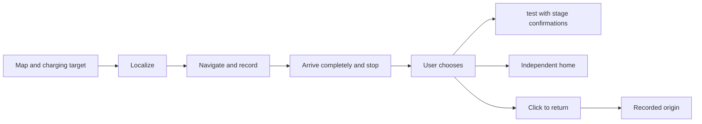
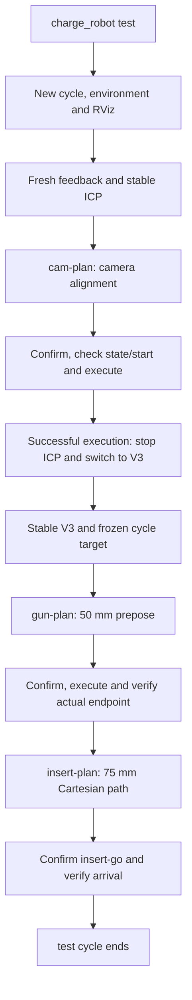
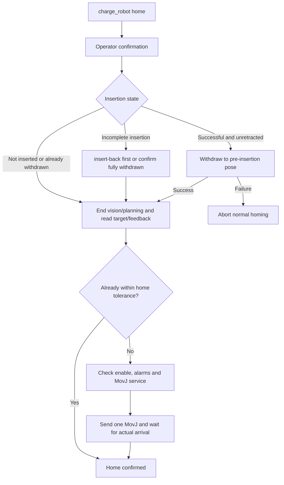
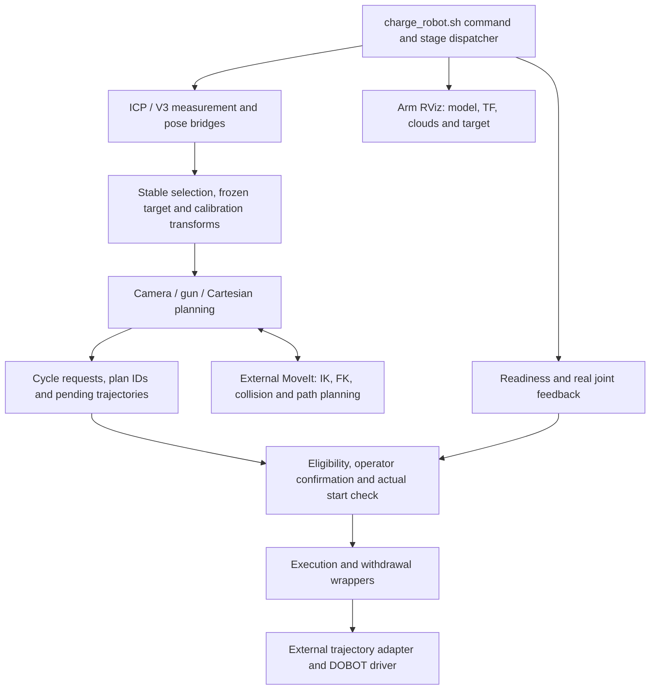
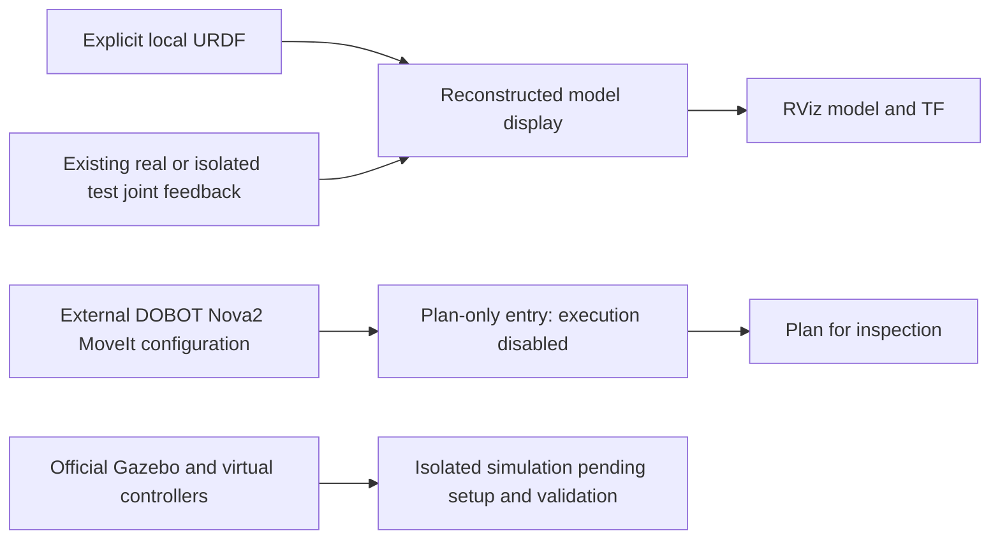

# Autonomous Charging Robot for GB/T Electric Vehicles

**Arm sources partially included:** charge_robot, ICP, V3, arm simulation and planning applications are authored by Pvpproof. [arm_stack](arm_stack/README.md) contains 40 available historical source/display files and two inactive algorithm examples. Runtime modules and complete simulation assets remain missing; current field identity and deployability are not claimed.

[中文](README.md) · [Architecture](docs/ARCHITECTURE.en.md) · [Deployment](docs/DEPLOYMENT.en.md) · [Testing](docs/TESTING.en.md)

A robotics R&D project integrating mobile navigation, recorded-odometry return and arm docking tools in a PyQt5 / ROS 2 workstation. It demonstrates asynchronous control, state management, modular integration and fault diagnosis, with reusable components for further development.

The title describes the application domain, not standards certification or a validated unattended electrical charging system. Thesis text, site maps, trajectories, calibration and vendor implementations are excluded.

Added [eight traceable historical source files](arm_stack/recovered/README.md), including planning and bridges; completeness and current field identity remain unverified.

## Workflow

The panel has three independent sections: maps/targets/manual control, localization/outbound/return, and arm tools. Arm success is not a prerequisite for return.



Cancelled outbound runs are not eligible return records. Return tracks reversed poses within the same raw-odometry session using linear/angular commands; it is not timed command replay. Ordinary stop cancels intent without automatically resuming old tasks.

## Architecture


## Arm and vision

[arm_stack](arm_stack/README.md) contains project-owned test/home workflow, ICP point-cloud matching, V3 RGB PnP, feedback, camera alignment, gun prepose, Cartesian insertion planning and execution wrappers. Panel buttons still use a separately installed tool environment; this archive does not replace field software.

There are 40 historical source/display files with differentiated provenance, plus five explicitly reconstructed files for file status/writing, model display and plan-only startup. This is not an accepted current hardware release. The owner selected 75 mm; public planning and execution policy now agree. Field files were not changed and the update is not field-tested.

## charge_robot test: vision alignment through insertion

`charge_robot test` performs **ICP socket localization → camera alignment → V3 measurement → gun prepose → 75 mm linear insertion**. Planning and vision stages are sequenced automatically, while every motion requires a separate terminal confirmation. This describes the included implementation; [deployment dependencies and configuration remain incomplete](arm_stack/README.md).

1. **Start a new cycle.** Check that execution is idle, clean up previous vision/planning processes, create a new cycle and start the real connection, joint feedback, model/TF, planning-only MoveIt, execution adapter, ICP, pose/cloud bridge and arm RViz. Startup does not automatically home the arm.
2. **Wait for readiness and stable ICP.** Require real connection, fresh complete joints, an actual GetPose response, MoveIt interfaces and valid ICP geometry. Stable measurements and hand-eye calibration provide the planning target.
3. **Plan and execute camera alignment.** `cam-plan` saves a request-bound trajectory. After operator confirmation, validate robot state, eligibility and actual start before execution. Failure prevents the vision transition.
4. **Switch to V3.** Only after successful, matching camera execution, stop the ICP camera/bridge/planner, release the camera and start RGB PnP V3 with its bridge. Freeze a stable representative target for this cycle.
5. **Plan and execute the gun prepose.** `gun-plan` targets a 50 mm standoff using the frozen measurement. Confirm again, verify the start, execute and check the actual gun endpoint. Then close V3/bridge/planning nodes while retaining connection, model, MoveIt and RViz.
6. **Plan the 75 mm insertion.** `insert-plan` binds to the accepted gun prepose, generates/refines a Cartesian line, checks sampled states and saves the trajectory without executing it.
7. **Confirm and execute insertion.** `insert-go` checks plan/cycle binding, depth, enabled stationary state and actual start. After confirmation, submit the trajectory and verify execution plus actual joint arrival. This is position-controlled insertion, not proof of locking, electrical connection or charging.



Required check, planning or execution failures stop subsequent stages. An interruption request does not establish that physical motion has stopped. `test` does not automatically invoke `home` or base return.

## charge_robot home: withdrawal and arm homing

`home` independently returns the arm to the locally saved `initial_arm_pose.yaml`; this is not the mobile base origin.

1. **Confirm homing.** Load the tool environment and request operator confirmation. When an insertion report exists, check the required execution interface.
2. **Determine withdrawal.** Successful, unretracted insertion triggers withdrawal before normal homing; withdrawal failure aborts homing. Incomplete insertion prompts `insert-back` first. The code also permits explicit `HOME` override after the operator confirms the tool is already completely withdrawn. Unreadable state refuses continuation.
3. **End vision/planning.** Check execution is idle, stop ICP/V3/planners and transition the cycle to homing.
4. **Read target and actual joints.** Load the saved pose and inspect feedback/RobotMode. If already within tolerance, send no motion. Otherwise require an enabled, alarm-free state.
5. **Send one home request and verify arrival.** Submit joint targets through `MovJ`, then wait for stable actual arrival. Service acceptance alone is not completion; a response timeout does not automatically resend motion.



Panel test, home and base return are separately initiated. Arm workflow success is not a base-return prerequisite. See [reconstruction notes](arm_stack/RECONSTRUCTION.md) for historical/reconstructed sources and unverified integration.

### Toolchain architecture



`test` does not automatically invoke `home` or base return. Arm tools and recorded-route base return remain independent. Command completion does not establish mechanical locking, electrical connection or charging. Reconstructed status/writing and model-startup helpers are identified in the [reconstruction notes](arm_stack/RECONSTRUCTION.md).

## Simulation and planning



Model-display and plan-only wrappers are included; fake joint publishers, site calibration and a complete Gazebo project are not. Six official model/MoveIt files match historical field hashes, but the complete field revision, meshes and execution adapter still need verification. Pin external dependencies and preserve Dobot notices; see [upstream audit](arm_stack/DOBOT_DEPENDENCY.md).

Source inspection and synthetic tests work without hardware when test dependencies are installed. Actual model/planning visualization requires the reviewed upstream stack. No RViz/MoveIt/Gazebo or hardware run was performed in this update. There are 61 passing targeted tests; these do not establish end-to-end simulation or hardware acceptance.

## Evidence and limits

| Capability | Evidence | Remaining limits |
| --- | --- | --- |
| Mapping, manual control, outbound navigation | Historical field use | No general accuracy claim |
| Click-to-return | User reported complete return on earlier versions; offline regressions | Latest changes and source reorganization need new field acceptance |
| ICP alignment and V3 pre-insertion pose | User-provided successful stage logs | Later insertion timed out; full electrical charging is unverified |
| Stop, disconnect, cancellation | Synthetic input, fake publishers, offline Qt tests | Not hardware acceptance |
| Hardware emergency stop and controller disconnect stop | User confirmation | Not an automated test result |

## Start without hardware

With system Python, PyQt5, NumPy, Pillow and PyYAML installed:

```bash
bash start.sh --offline
```

This does not connect to devices. `bash tests/run_local.sh` runs hardware-free regression tests in a ROS 2 Humble development environment. Public configuration disables hardware operation. See the deployment and testing guides before integration.

## Source layout

`src/charging_robot/` contains `ui`, `navigation`, `returning`, `arm`, `control` and `shared`. `native/` contains project-owned C++ helpers; `tests/` contains regression fixtures. Original `start.sh`, `app.py` and launch entry points remain available. See [path mapping](docs/source-layout.json) and [provenance](docs/source-manifest.json).

Recorded routes cannot detect new obstacles or eliminate wheel slip. Uncalibrated curvature classification has been removed, while controller output limits and communication/state checks remain. Healthy autonomous control may continue while the GUI is stalled; its stop button may be unavailable, requiring an independent hardware emergency stop.

Pvpproof-owned code is [MIT licensed](LICENSE). Third-party dependencies retain their terms; see [notices](THIRD_PARTY_NOTICES.md) and [dependency audit](DEPENDENCIES.md), including PyQt GPL/commercial options and unresolved vendor licensing.

[Contributing](CONTRIBUTING.en.md) · [Changelog](CHANGELOG.md)
