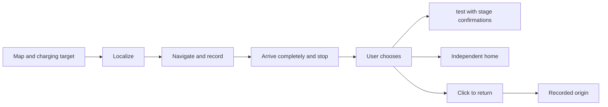
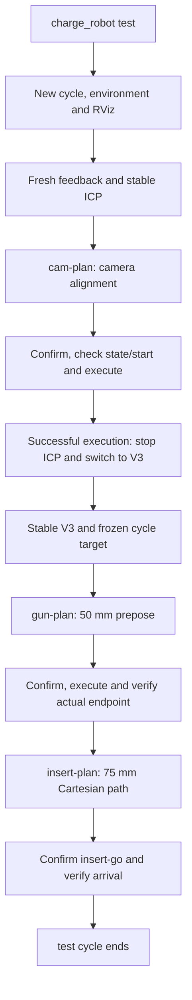
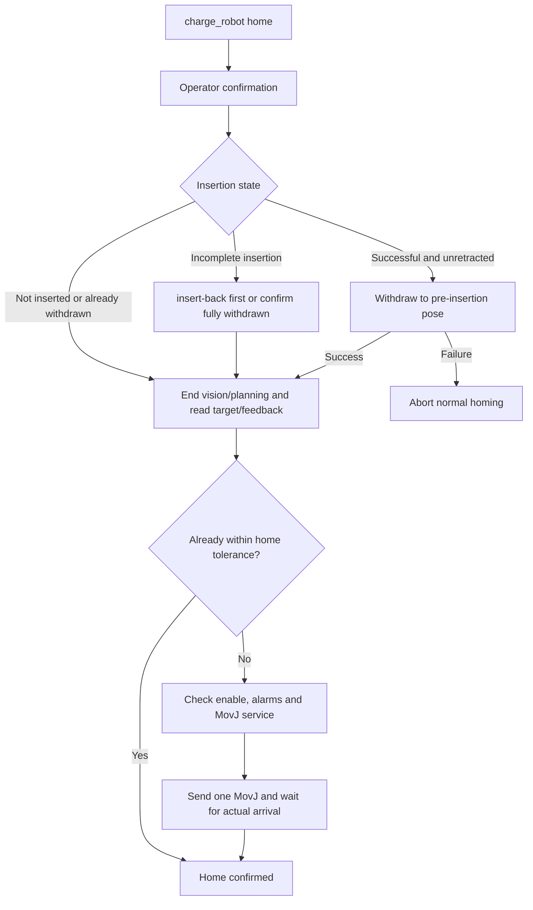
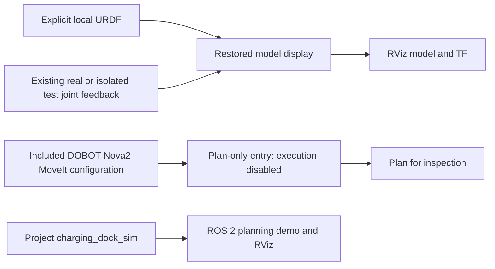

# Autonomous Charging Robot for GB/T Electric Vehicles

See [environment and completeness](robot_originals/ENVIRONMENT.md): 599 original files are included; system dependencies and runtime acceptance remain separate deployment steps.

**2026-11-09 field-source recovery:** Original charge_robot, ICP, V3, startup and project simulation files have been retrieved read-only and supersede the reconstructed implementations. See [provenance and scope](arm_stack/README.md). At the owner’s request, [robot_originals](robot_originals/README.md) now includes the exact originals, vendor dependencies and this robot’s calibration with a layout-preserving copy tool. No device execution occurred.

**A ROS 2 / PyQt5 R&D workstation combining mobile navigation, visual localization, arm insertion and recorded-route return for GB/T charging interfaces.**

[中文](README.md) · [Documentation](docs/README.md) · [Deployment](docs/DEPLOYMENT.en.md) · [Testing](docs/TESTING.en.md)

Break the journey from reaching a charging point to locating the socket, staged docking and returning to origin into observable, independently operated and tested modules. Navigation, return and visual pre-docking have historical field evidence; the current public copy still needs end-to-end acceptance. Unattended electrical charging and standards certification are unverified.


Green means historical field records or user reports; blue means hardware-free software checks; amber means current hardware validation pending; gray means missing integration. This is not live device status. [Evidence and limits](docs/VALIDATION.md)

## Key technologies

| Module | Problem addressed | Evidence and current limits |
| --- | --- | --- |
| Base navigation | Nav2 and a shared map panel navigate to a charging point while recording a complete outbound route. | Historical field use; drivers, maps and navigation parameters are external. |
| Visual localization | Coarse ICP followed by stable V3 RGB PnP provides camera alignment and gun prepose targets. | Successful stage logs exist; they do not establish insertion success. |
| Arm insertion | A frozen cycle target links camera alignment, gun prepose and 75 mm Cartesian insertion planning. | The original target is 75 mm with per-motion confirmation; this published bundle has not been retested on hardware, and historical insertion timed out. |
| Recorded-route return | Reversed measured poses within one raw-odometry session guide return instead of timed velocity replay. | User-reported success on earlier versions; current revision pending, with no new-obstacle detection. |
| Control and diagnostics | One velocity arbiter, backend leases, fresh feedback and cancellation state coordinate command sources. | Synthetic and offline Qt regression; independent emergency stop remains necessary. |
| Model and planning | Explicit models and execution-disabled MoveIt wrappers support model and planning inspection. | Original Nova2 models, MoveIt, execution adapter and project simulation are included; runtime acceptance is pending and the separate Gazebo package is absent. |

## Quick start

With system Python, PyQt5, NumPy, Pillow and PyYAML installed, run from the repository root:

```bash
bash start.sh --offline
```

The preview does not connect to hardware; no field maps are bundled. Use `bash tests/run_arm.sh` for static and synthetic arm checks (system Python and NumPy), and `bash tests/run_local.sh` for workstation regression (also requires ROS 2 Humble Python packages). [Testing guide](docs/TESTING.en.md)

Read the [deployment guide](docs/DEPLOYMENT.en.md) and [robot recovery guide](docs/本车恢复说明.md) before integration. Public panel configuration stays `disabled` and `commissioned=false`. Original arm sources, DOBOT dependencies, the template and robot-specific calibration are in `robot_originals/`. Install ROS, camera drivers and Python dependencies separately; configure base drivers, maps and navigation parameters for the actual device. See [environment requirements](robot_originals/ENVIRONMENT.md).

## Demo video

**Demo video to be added.**

## Module details and workflows

<details>
<summary>Base, return and control: operation choices and boundaries</summary>

## Workflow

The panel has three independent sections: maps/targets/manual control, localization/outbound/return, and arm tools. Arm success is not a prerequisite for return.



Cancelled outbound runs are not eligible return records. Return tracks reversed poses within the same raw-odometry session using linear/angular commands; it is not timed command replay. Ordinary stop cancels intent without automatically resuming old tasks.

## Architecture


</details>
<details>
<summary>Vision and arm: source scope and integration gaps</summary>

[robot_originals](robot_originals/README.md) contains 599 hash-verified field-original files: `charge_robot test/home`, ICP/V3, the socket point-cloud template, hand-eye calibration, home pose, tool compensation, project simulation and the current DOBOT driver/model/MoveIt dependencies. Original implementations replace the earlier reconstructed workflow. [arm_stack](arm_stack/README.md) is a path-adapted reading view; use `robot_originals/` for same-robot restoration. The panel calls separately deployed tools through independent terminals. [Environment and remaining validation](robot_originals/ENVIRONMENT.md)

</details>
<details>
<summary>test: ICP → camera alignment → V3 → prepose → insertion</summary>

Included implementation path; each motion requires confirmation. `test` does not automatically home or return the base.



[逐步说明 / Step-by-step guide](docs/ARM_WORKFLOWS.en.md)

</details>
<details>
<summary>home: withdrawal and arm homing</summary>

`home` means the saved arm pose, not the base origin; failed withdrawal aborts normal homing.



[逐步说明 / Step-by-step guide](docs/ARM_WORKFLOWS.en.md)

</details>
<details>
<summary>Model and planning: external dependencies and validation limits</summary>

## Simulation and planning



The bundle includes the original model launch, Nova2 URDF/SRDF/meshes, MoveIt configuration, execution adapter and project `charging_dock_sim`. Robot-specific hand-eye calibration is in `robot_originals/`. The simulation example uses a distinct 35 mm insertion setting; the real arm toolchain uses 75 mm. The separate `dobot_gazebo` physics package is absent, and no simulation was built or run during publication. Original Dobot notices are preserved. Missing field Git metadata prevents identifying the whole vendor snapshot as one upstream commit. See [upstream audit](arm_stack/DOBOT_DEPENDENCY.md) and [environment notes](robot_originals/ENVIRONMENT.md).

</details>

## Repository guide

| Path | Contents |
| --- | --- |
| `src/charging_robot/` | Six packages: `ui`, `navigation`, `returning`, `arm`, `control`, `shared` |
| [robot_originals/](robot_originals/README.md) | 599 field-original files, calibration/template, DOBOT dependencies, hashes and restoration tool |
| [arm_stack/](arm_stack/README.md) | Source reading view derived from arm, vision and simulation originals, with provenance |
| [native/](native/driver-watchdog/README.md) | Owned raw-odometry relay, command watchdog and PTY tests |
| [docs/](docs/README.md) | Architecture, workflows, deployment, testing, dependencies and evidence |
| [config/](config/README.md) · [examples/](examples/nav2.placeholder.yaml) | Disabled public configuration and a navigation-rejected placeholder |
| [tests/](tests/README.md) | Workstation regression, synthetic archive tests and separately isolated ROS integration |

Original `start.sh`, `app.py`, `navigation.launch.py` and other compatibility entries remain. The [source mapping](docs/source-layout.json) is unchanged.

## Validation and licensing

[Validation notes](docs/VALIDATION.md) distinguish historical field evidence, user reports and current offline checks. Source inclusion and passing software tests are not hardware acceptance. Raw odometry cannot eliminate wheel slip; return cannot detect new obstacles. Healthy backend control may continue during a GUI stall, requiring independent emergency stop.

Project-owned application code and original SVG diagrams use [MIT](LICENSE); the original project simulation retains Apache-2.0. Bundled DOBOT originals retain the Dobot LICENSE and package-level declarations. PyQt and mapping dependencies retain their own terms. Robot-specific calibration/configuration is published with the owner’s authorization; passwords, keys, unrelated runtime logs and actual navigation maps/routes are excluded. [Third-party notices](THIRD_PARTY_NOTICES.md) · [Dependency audit](docs/DEPENDENCIES.md)

[Contributing](CONTRIBUTING.en.md) · [Changelog](CHANGELOG.md) · [Source provenance](docs/source-manifest.json)

## Complete system download scope

The download covers this entire repository: mobile-base panel, maps/targets, navigation and recorded-route return, arm test/home, ICP/V3, template and robot-specific calibration, DOBOT models/MoveIt, project simulation and documentation. It is a complete repository source bundle, not an arm-only archive or OS image. Install external dependencies as documented; the separate Gazebo physics package is not included.
