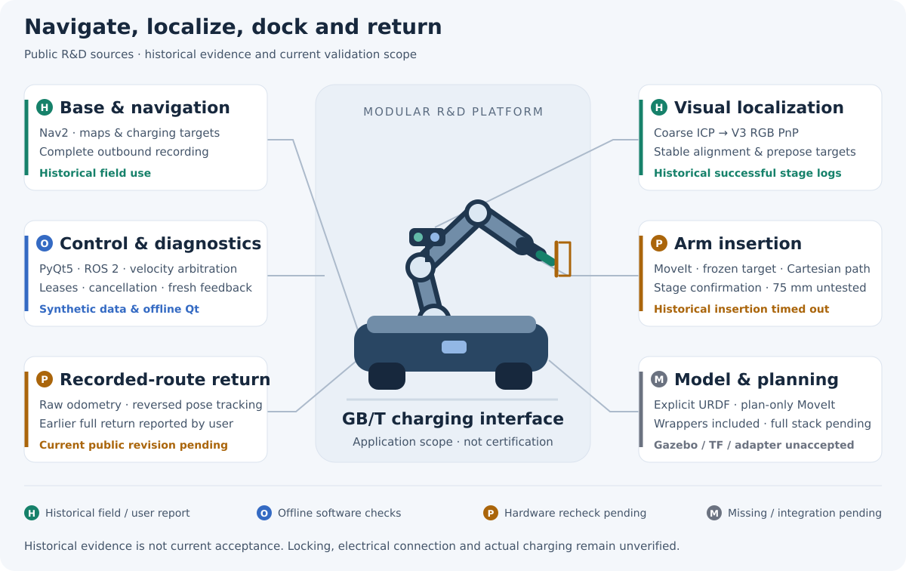
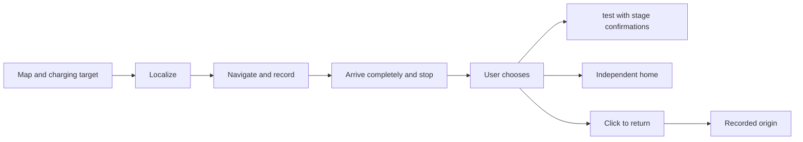
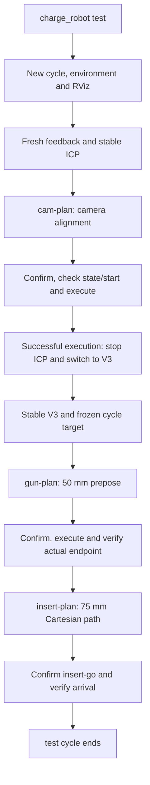
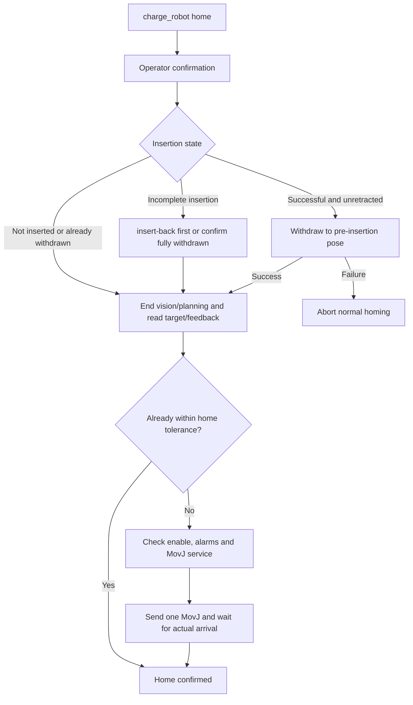
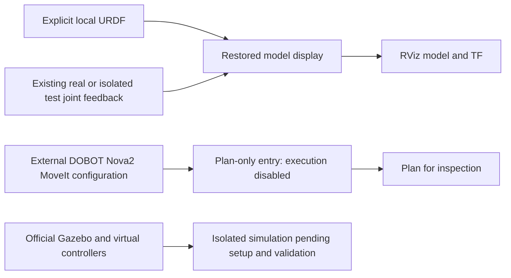

# Autonomous Charging Robot for GB/T Electric Vehicles

See [environment and completeness](robot_originals/ENVIRONMENT.md): 599 original files are included; system dependencies and runtime acceptance remain separate deployment steps.

**2026-11-09 field-source recovery:** Original charge_robot, ICP, V3, startup and project simulation files have been retrieved read-only and supersede the reconstructed implementations. See [provenance and scope](arm_stack/README.md). At the owner’s request, [robot_originals](robot_originals/README.md) now includes the exact originals, vendor dependencies and this robot’s calibration with a layout-preserving copy tool. No device execution occurred.

**A ROS 2 / PyQt5 R&D workstation combining mobile navigation, visual localization, arm insertion and recorded-route return for GB/T charging interfaces.**

[中文](README.md) · [Documentation](docs/README.md) · [Deployment](docs/DEPLOYMENT.en.md) · [Testing](docs/TESTING.en.md)

Break the journey from reaching a charging point to locating the socket, staged docking and returning to origin into observable, independently operated and tested modules. Navigation, return and visual pre-docking have historical field evidence; the current public copy still needs end-to-end acceptance. Unattended electrical charging and standards certification are unverified.



Green means historical field records or user reports; blue means hardware-free software checks; amber means current hardware validation pending; gray means missing integration. This is not live device status. [Evidence and limits](docs/VALIDATION.md)

## Key technologies

| Module | Problem addressed | Evidence and current limits |
| --- | --- | --- |
| Base navigation | Nav2 and a shared map panel navigate to a charging point while recording a complete outbound route. | Historical field use; drivers, maps and navigation parameters are external. |
| Visual localization | Coarse ICP followed by stable V3 RGB PnP provides camera alignment and gun prepose targets. | Successful stage logs exist; they do not establish insertion success. |
| Arm insertion | A frozen cycle target links camera alignment, gun prepose and 75 mm Cartesian insertion planning. | Operator confirms each motion; public 75 mm policy is untested on hardware and historical insertion timed out. |
| Recorded-route return | Reversed measured poses within one raw-odometry session guide return instead of timed velocity replay. | User-reported success on earlier versions; current revision pending, with no new-obstacle detection. |
| Control and diagnostics | One velocity arbiter, backend leases, fresh feedback and cancellation state coordinate command sources. | Synthetic and offline Qt regression; independent emergency stop remains necessary. |
| Model and planning | Explicit models and execution-disabled MoveIt wrappers support model and planning inspection. | Wrappers included; complete Gazebo, TF, model assets and execution integration remain unaccepted. |

## Quick start

With system Python, PyQt5, NumPy, Pillow and PyYAML installed, run from the repository root:

```bash
bash start.sh --offline
```

The preview does not connect to hardware; no field maps are bundled. Use `bash tests/run_arm.sh` for static and synthetic arm checks (system Python and NumPy), and `bash tests/run_local.sh` for workstation regression (also requires ROS 2 Humble Python packages). [Testing guide](docs/TESTING.en.md)

Read the [deployment guide](docs/DEPLOYMENT.en.md) before integration. Public configuration stays `disabled` and `commissioned=false`; vendor drivers, site configuration and a complete arm environment are supplied separately.

## Demo video

**Demo video to be added.**

## Module details and workflows

<details>
<summary>Base, return and control: operation choices and boundaries</summary>

## Workflow

The panel has three independent sections: maps/targets/manual control, localization/outbound/return, and arm tools. Arm success is not a prerequisite for return.



Cancelled outbound runs are not eligible return records. Return tracks reversed poses within the same raw-odometry session using linear/angular commands; it is not timed command replay. Ordinary stop cancels intent without automatically resuming old tasks.

## Architecture


</details>
<details>
<summary>Vision and arm: source scope and integration gaps</summary>

[arm_stack](arm_stack/README.md) contains 40 historical source/display files, five explicitly limited reconstructions and two inactive algorithm examples. Manifests distinguish provenance strength. Panel tools still use a separate installation; this is not a complete deployable toolchain. [Missing items](arm_stack/README.md#未完成--missing-or-unverified) · [Reconstruction](arm_stack/RECONSTRUCTION.md) · [Source status](docs/ARM_SOURCE_SCOPE.md)

</details>
<details>
<summary>test: ICP → camera alignment → V3 → prepose → insertion</summary>

Included implementation path; each motion requires confirmation. `test` does not automatically home or return the base.



[逐步说明 / Step-by-step guide](docs/ARM_WORKFLOWS.en.md)

</details>
<details>
<summary>home: withdrawal and arm homing</summary>

`home` means the saved arm pose, not the base origin; failed withdrawal aborts normal homing.



[逐步说明 / Step-by-step guide](docs/ARM_WORKFLOWS.en.md)

</details>
<details>
<summary>Model and planning: external dependencies and validation limits</summary>

## Simulation and planning



Original model-display and plan-only wrappers and the project simulation package are included; site calibration and external vendor assets remain separate. Six official model/MoveIt files match historical field hashes, but the complete field revision, meshes and execution adapter still need verification. Pin external dependencies and preserve Dobot notices; see [upstream audit](arm_stack/DOBOT_DEPENDENCY.md).

</details>

## Repository guide

| Path | Contents |
| --- | --- |
| `src/charging_robot/` | Six packages: `ui`, `navigation`, `returning`, `arm`, `control`, `shared` |
| [arm_stack/](arm_stack/README.md) | Owned historical arm/vision sources, provenance and reconstruction notes |
| [native/](native/driver-watchdog/README.md) | Owned raw-odometry relay, command watchdog and PTY tests |
| [docs/](docs/README.md) | Architecture, workflows, deployment, testing, dependencies and evidence |
| [config/](config/README.md) · [examples/](examples/nav2.placeholder.yaml) | Disabled public configuration and a navigation-rejected placeholder |
| [tests/](tests/README.md) | Workstation regression, synthetic archive tests and separately isolated ROS integration |

Original `start.sh`, `app.py`, `navigation.launch.py` and other compatibility entries remain. The [source mapping](docs/source-layout.json) is unchanged.

## Validation and licensing

[Validation notes](docs/VALIDATION.md) distinguish historical field evidence, user reports and current offline checks. Source inclusion and passing software tests are not hardware acceptance. Raw odometry cannot eliminate wheel slip; return cannot detect new obstacles. Healthy backend control may continue during a GUI stall, requiring independent emergency stop.

Owned code and the original SVG diagrams are [MIT licensed](LICENSE). External terms remain separate: PyQt GPL/commercial licensing, historical mapping-package noncommercial metadata and unresolved vendor permissions need review. No third-party imagery, SDKs, models, field photos, maps, routes, site calibration or credentials were added. [Third-party notices](THIRD_PARTY_NOTICES.md) · [Dependency audit](docs/DEPENDENCIES.md)

[Contributing](CONTRIBUTING.en.md) · [Changelog](CHANGELOG.md) · [Source provenance](docs/source-manifest.json)

## Complete system download scope

The download covers this entire repository: mobile-base panel, maps/targets, navigation and recorded-route return, arm test/home, ICP/V3, template and robot-specific calibration, DOBOT models/MoveIt, project simulation and documentation. It is a complete repository source bundle, not an arm-only archive or OS image. Install external dependencies as documented; the separate Gazebo physics package is not included.
