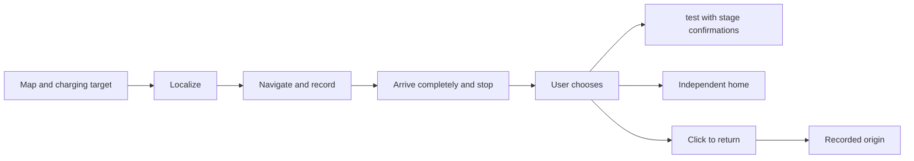
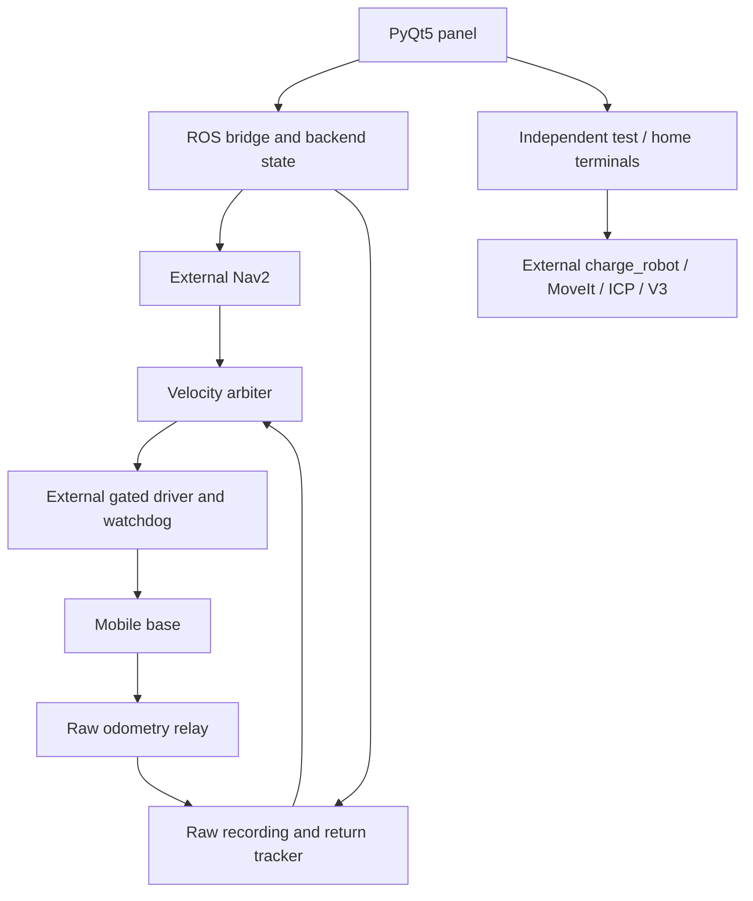

# Autonomous Charging Robot for GB/T Electric Vehicles

[中文](README.md) · [Architecture](docs/ARCHITECTURE.en.md) · [Deployment](docs/DEPLOYMENT.en.md) · [Testing](docs/TESTING.en.md)

A robotics R&D project integrating mobile navigation, recorded-odometry return and arm docking tools in a PyQt5 / ROS 2 workstation. It demonstrates asynchronous control, state management, modular integration and fault diagnosis, with reusable components for further development.

The title describes the application domain, not standards certification or a validated unattended electrical charging system. Thesis text, site maps, trajectories, calibration and vendor implementations are excluded.

## Workflow

The panel has three independent sections: maps/targets/manual control, localization/outbound/return, and arm tools. Arm success is not a prerequisite for return.



Cancelled outbound runs are not eligible return records. Return tracks reversed poses within the same raw-odometry session using linear/angular commands; it is not timed command replay. Ordinary stop cancels intent without automatically resuming old tasks.

## Architecture



## Evidence and limits

| Capability | Evidence | Remaining limits |
| --- | --- | --- |
| Mapping, manual control, outbound navigation | Historical field use | No general accuracy claim |
| Click-to-return | User reported complete return on earlier versions; offline regressions | Latest changes and source reorganization need new field acceptance |
| ICP alignment and V3 pre-insertion pose | User-provided successful stage logs | Later insertion timed out; full electrical charging is unverified |
| Stop, disconnect, cancellation | Synthetic input, fake publishers, offline Qt tests | Not hardware acceptance |
| Hardware emergency stop and controller disconnect stop | User confirmation | Not an automated test result |

## Start without hardware

With system Python, PyQt5, NumPy, Pillow and PyYAML installed:

```bash
bash start.sh --offline
```

This does not connect to devices. `bash tests/run_local.sh` runs hardware-free regression tests in a ROS 2 Humble development environment. Public configuration disables hardware operation. See the deployment and testing guides before integration.

## Source layout

`src/charging_robot/` contains `ui`, `navigation`, `returning`, `arm`, `control` and `shared`. `native/` contains project-owned C++ helpers; `tests/` contains regression fixtures. Original `start.sh`, `app.py` and launch entry points remain available. See [path mapping](docs/source-layout.json) and [provenance](docs/source-manifest.json).

Recorded routes cannot detect new obstacles or eliminate wheel slip. Uncalibrated curvature classification has been removed, while controller output limits and communication/state checks remain. Healthy autonomous control may continue while the GUI is stalled; its stop button may be unavailable, requiring an independent hardware emergency stop.

Pvpproof-owned code is [MIT licensed](LICENSE). Third-party dependencies retain their terms; see [notices](THIRD_PARTY_NOTICES.md) and [dependency audit](DEPENDENCIES.md), including PyQt GPL/commercial options and unresolved vendor licensing.

[Contributing](CONTRIBUTING.en.md) · [Changelog](CHANGELOG.md)
