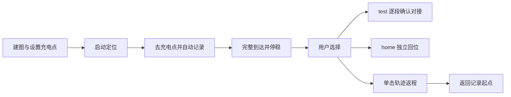
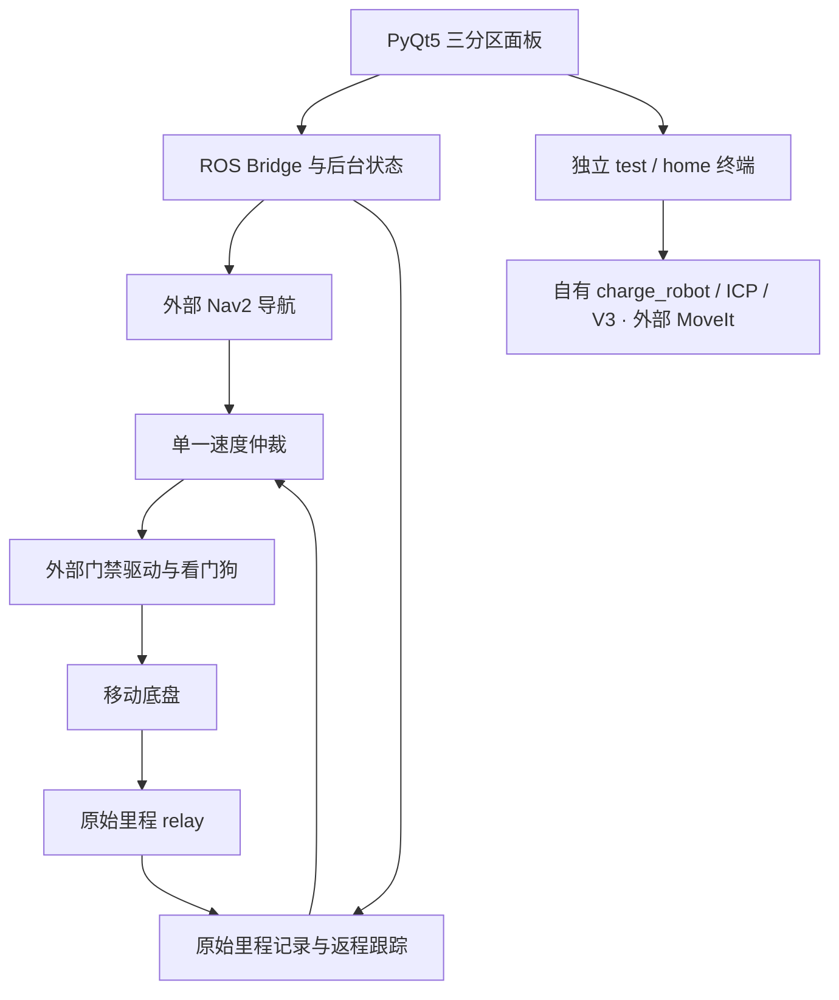
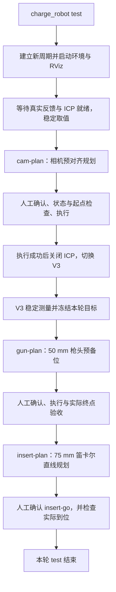
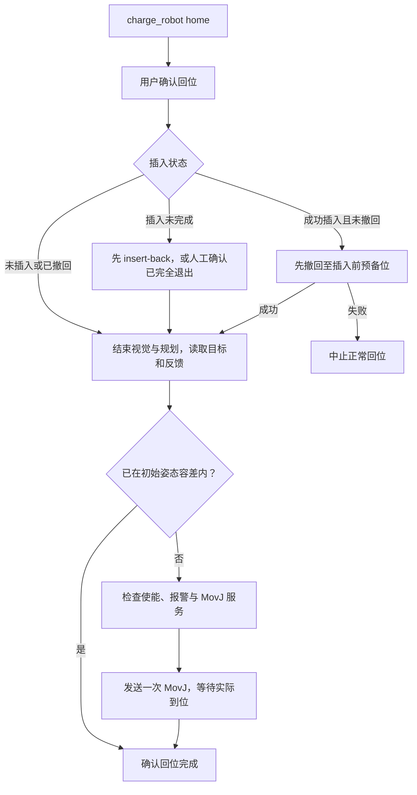
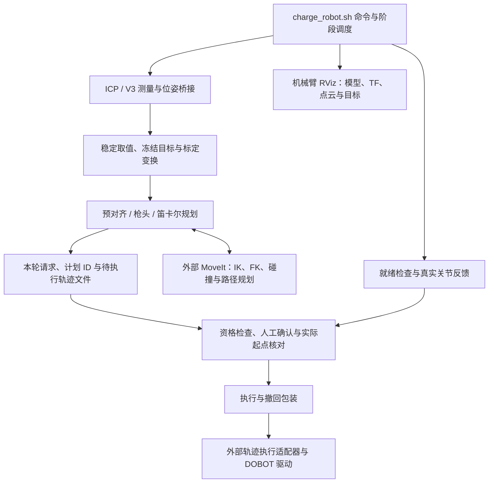
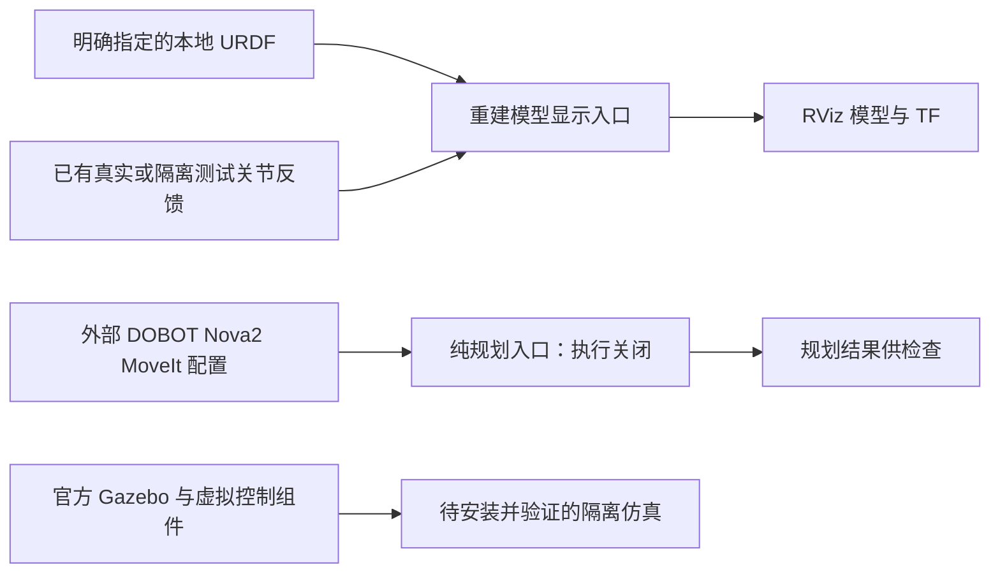

# 国标电车自动充电机器人

**机械臂源码已部分收录：** `charge_robot`、ICP、V3、机械臂仿真与规划应用由 Pvpproof 自写。已整理 40 个可得历史源码/显示文件及 2 个未启用算法示例，见 [arm_stack](arm_stack/README.md)。当前现场离线，运行模块和完整仿真资产仍有缺件，不声称这是可直接部署的最新完整版本。

[English](README.en.md) · [架构](docs/ARCHITECTURE.md) · [部署](docs/DEPLOYMENT.md) · [测试](docs/TESTING.md)

面向国标电车充电场景的机器人研发项目：将移动底盘导航、实际里程轨迹返程和机械臂对接工具整合到 PyQt5 / ROS 2 工作台。项目展示异步控制、状态管理、模块解耦和故障诊断的工程实现，也为二次开发提供可独立测试的模块。

项目名称描述应用方向，不代表已经通过国标认证或完成无人值守电气充电验收。仓库不公开论文正文、现场地图、轨迹、标定或厂家代码。

已补入 [8 个可追溯历史文件](arm_stack/recovered/README.md)，含规划与桥接源码；完整工具链和最新现场版本仍待核对。

## 操作流程

同一面板分为地图与点位、定位与去返程、机械臂工具三个区域。到点后由用户分别选择工具和返程，不要求机械臂成功才能返程。



中途取消的去程不形成可返程记录。返程按同一原始里程计会话中的倒序位姿闭环计算线速度、角速度，不按时间机械重播速度。普通停止取消当前任务；旧任务不会自动恢复。

## 功能架构



本仓库包含面板、桥接、记录/返程、仲裁及自有原生辅助组件；自有机械臂算法工具链待补齐，厂家驱动和专用标定另行配置。

## 机械臂与视觉

自有源码位于 [arm_stack](arm_stack/README.md)：`charge_robot test/home` 工作流、ICP 点云匹配、V3 RGB PnP、真实关节反馈、相机预对齐、枪头预备位、笛卡尔插入规划与执行包装。面板按钮仍调用单独安装的工具环境，本次归档不会自动替换现场程序。

当前收录 40 个历史源码/显示文件，按安装回执匹配、历史记录匹配或缓存来源分别标注；另有 5 个明确标记的重建文件（文件状态/写入、模型显示和纯规划启动）。它们不是已经整体验收的当前实机版本。按用户后期选择，公开副本已统一为 75 mm；未修改现场，当前未实测。

## charge_robot test：从视觉定位到插入

`charge_robot test` 执行一轮机械臂预对接与插入：**ICP 找充电口 → 相机预对齐 → V3 精测 → 枪头预备位 → 75 mm 直线插入**。程序自动衔接规划和视觉阶段，每段运动仍在终端单独确认。以下是收录代码的预期流程，完整部署仍有[依赖和配置缺项](arm_stack/README.md)。

1. **启动本轮环境。** 检查执行器是否空闲，清理上一轮视觉/规划进程并建立新周期；启动真实连接、关节反馈、模型与 TF、MoveIt 纯规划、轨迹执行适配器、ICP、位姿/点云桥接和机械臂 RViz。此步骤不自动回初始姿态。
2. **等待 ICP 与机械臂就绪。** 检查真实连接、完整且新鲜的关节反馈、GetPose 实际响应、MoveIt 接口和有效 ICP 几何位姿。多帧稳定取值后，结合手眼标定把相机测量转换为机械臂规划目标。
3. **规划并执行相机预对齐。** `cam-plan` 计算预对齐轨迹并保存本轮请求及计划 ID。终端要求确认工作区后，核对机器人状态、计划资格和真实起点，再提交执行；失败则不切换下一视觉阶段。
4. **切换为 V3 精测。** 相机轨迹执行成功且请求匹配后，关闭 ICP 相机、桥接与相机规划节点，释放相机，再启动 RGB PnP V3 及其桥接。V3 多帧稳定后冻结本轮代表目标，避免规划过程中不断追逐更新值。
5. **规划并执行枪头预备位。** `gun-plan` 使用冻结目标规划距充电口 50 mm 的枪头预备位。再次由用户确认，检查实际起点后执行，并核对实际枪头终点。该阶段结束后关闭 V3、桥接和相关规划节点，保留连接、模型、MoveIt 与 RViz。
6. **规划 75 mm 轴向插入。** `insert-plan` 以本轮已验收的枪头预备位为来源，生成笛卡尔直线路径、进行细化与采样检查，保存插入计划；此时尚未运动。
7. **确认并执行插入。** `insert-go` 检查计划/周期绑定、75 mm 范围、静止使能状态与真实起点。终端再次确认后提交轨迹，读取执行结果并等待实际关节到位。这里是位置控制插入，不代表已经验证锁止、电气连接或充电。



任何必需检查、规划或执行失败都会中止后续步骤；中断请求本身不证明机械臂已经停稳。`test` 结束后不会自动 `home` 或启动底盘返程。

## charge_robot home：撤回与机械臂回位

`home` 是独立的机械臂回位命令，目标来自本地保存的 `initial_arm_pose.yaml`，不是底盘起点。

1. **用户确认回位。** 加载工具环境，要求确认机械臂将回初始姿态；存在插入报告时先检查所需执行接口。
2. **判断是否先撤回。** 本轮插入成功且尚未撤回时，先调用撤回流程；撤回失败则中止正常回位。若插入未完成或状态不确定，提示先 `insert-back`；代码也保留人工确认枪头已完全退出后输入 `HOME`、跳过自动撤回的路径。状态文件无法可靠读取时拒绝继续。
3. **结束视觉与规划阶段。** 确认执行器空闲，关闭 ICP、V3 和相关规划节点，将本轮状态转为回位。
4. **读取目标与实际关节。** 加载保存的初始关节姿态，读取真实反馈和 RobotMode；若已在目标容差内，不发送回位运动。需要移动时，要求使能状态和无报警。
5. **发送一次回位并确认到达。** 经 `MovJ` 服务发送关节回位目标，等待实际关节稳定到位后才报告成功。服务返回成功只表示控制器接收；响应超时不自动重发，避免重复动作。



面板中的 `test`、`home` 和底盘返程分别由用户发起，不要求机械臂流程成功才能选择底盘返程。当前公开副本中的历史文件、重建入口和未实机验证部分见[重建说明](arm_stack/RECONSTRUCTION.md)。

### 工具链内部架构



`test` 不自动调用 `home` 或底盘返程；面板中的机械臂工具与底盘去返程独立。命令成功也不等于锁止、电气连接或实际充电已经验证。文件状态和写入辅助、模型启动中的重建部分见 [重建说明](arm_stack/RECONSTRUCTION.md)。

## 仿真与规划



已补模型显示与纯规划包装，但不含假关节发布器、现场手眼标定或完整 Gazebo 工程。官方 Nova2 URDF 和 5 个 MoveIt 配置与历史现场哈希一致；完整现场提交、网格依赖和执行适配器仍待核对。官方依赖应固定版本并保留 Dobot 版权，见 [DOBOT 来源与许可](arm_stack/DOBOT_DEPENDENCY.md)。

可以离线阅读和运行针对性合成测试；安装完整官方依赖后才具备模型/规划展示的前提，本轮没有启动 RViz/MoveIt/Gazebo，也没有完成仿真或实机全流程验收。当前相关测试共 61 项通过，详见 [重建边界](arm_stack/RECONSTRUCTION.md)与[收录状态](docs/ARM_SOURCE_SCOPE.md)。

## 验证状态

| 功能 | 已有证据 | 边界 |
| --- | --- | --- |
| 地图、键控、导航去程 | 历史现场使用记录 | 不承诺通用导航精度 |
| 单击原始里程返程 | 用户报告早期版本完整返程成功；本地回归 | 最新改动及目录整理未完成新一轮实车验收 |
| ICP 对齐、V3 枪头预备位 | 用户提供逐段执行成功日志 | 后续插入曾超时，完整电气充电未验证 |
| 停止、失联、任务取消 | 合成数据、假发布器和离线 Qt 回归 | 不替代真实设备验收 |
| 物理急停与下位机断连停车 | 用户报告验证 | 不表述为本仓库自动测试结果 |

## 快速开始

已安装 PyQt5、NumPy、Pillow、PyYAML 的系统 Python 可运行：

```bash
bash start.sh --offline
```

离线预览不连接设备。安装 ROS 2 Humble 的开发环境可运行 `bash tests/run_local.sh`，无需硬件，见[测试说明](docs/TESTING.md)。真实部署需要外部驱动、参数和现场配置，公开配置默认禁用，见[部署指南](docs/DEPLOYMENT.md)。

## 源码组织

| 路径 | 职责 |
| --- | --- |
| `src/charging_robot/ui` | 界面、地图画布和用户操作 |
| `src/charging_robot/navigation` | launch、定位辅助和显示管理 |
| `src/charging_robot/returning` | 记录、会话校验、返程控制 |
| `src/charging_robot/arm` | 外部机械臂工具包装 |
| `src/charging_robot/control` | ROS 桥接、仲裁、停止和看门狗 |
| `src/charging_robot/shared` | 共享模型与状态 |
| `native` / `tests` | 自有 C++ 辅助组件 / 无硬件回归 |

原 `start.sh`、`app.py` 和 ROS launch 等启动入口保留。模块路径映射见[来源布局](docs/source-layout.json)，迁移方式见[架构说明](docs/ARCHITECTURE.md)。

## 运行边界与许可

返程不能发现新增障碍，也不能消除轮滑误差。未经标定的曲率分类拦截已移除，控制器现有输出限幅及通信、轨迹状态检查仍存在。界面卡顿时健康的后台自主控制可能继续，界面停止按钮可能无法响应，需独立硬件急停。详见[返程实现](docs/RAW_ODOM_RETURN.md)。

Pvpproof 自有代码采用 [MIT](LICENSE)。依赖和厂家组件不因此获得 MIT 授权；PyQt 的 GPL/商业许可、建图依赖的非商业声明和不明厂家许可见[第三方边界](THIRD_PARTY_NOTICES.md)与[依赖核查](DEPENDENCIES.md)。

[贡献指南](CONTRIBUTING.md) · [更新日志](CHANGELOG.md) · [源码来源](docs/source-manifest.json)
