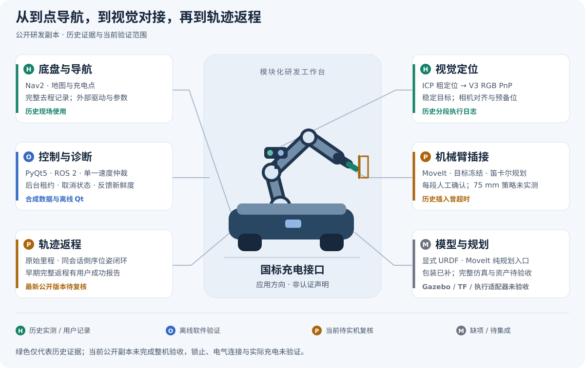
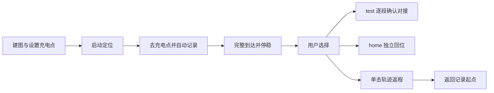
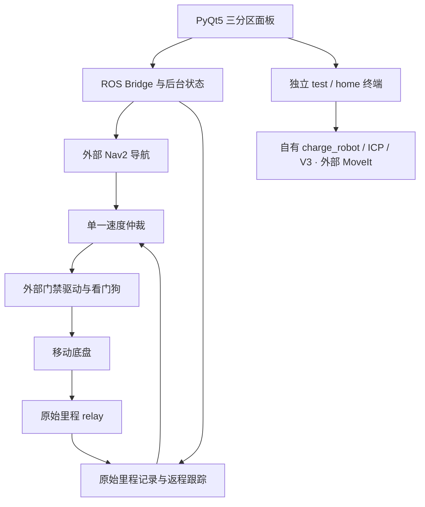
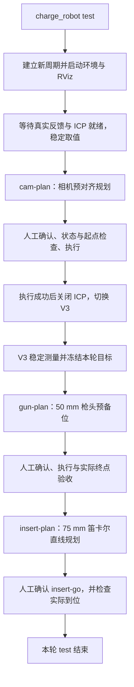
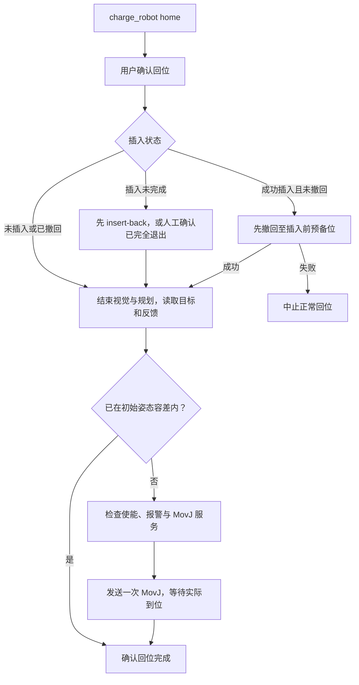

# 国标电车自动充电机器人

环境与文件齐备情况见 [同车原版环境说明](robot_originals/ENVIRONMENT.md)：当前 599 个原文件，环境软件通过文档安装，运行验收单独进行。

**2026-11-09 原件恢复：** 已从机器人只读补齐原版 charge_robot、ICP、V3、模型启动链和自有仿真包，替换昨日重建实现。源码/模板/配置已核对哈希，详情见 [原件恢复](arm_stack/README.md)。按用户要求，完整原版、现用 DOBOT 依赖及本车标定另收入 [robot_originals](robot_originals/README.md)，附带保留原目录布局的恢复工具；本轮未实机运行。

**面向国标充电接口，串联移动导航、视觉定位、机械臂插接与轨迹返程的 ROS 2 / PyQt5 研发工作台。**

[English](README.en.md) · [文档导航](docs/README.md) · [部署](docs/DEPLOYMENT.md) · [测试](docs/TESTING.md)

把“到达充电点—找准充电口—分段对接—返回起点”拆成可观察、可单独操作和测试的模块，方便定位问题、复用算法与继续集成。已有导航、返程和视觉预对接的历史实测记录；当前公开副本仍需整体验收，未验证无人值守电气充电，也不代表国标认证。



图中绿色指历史现场记录或用户报告，蓝色指无硬件软件验证，黄色指当前待实机复核，灰色指缺项；均不是实时设备状态。[证据与边界](docs/VALIDATION.md)

## 关键技术

| 模块 | 解决的问题 | 证据与当前边界 |
| --- | --- | --- |
| 底盘导航 | 用 Nav2 与统一地图面板把机器人送到充电点，并记录完整去程。 | 历史现场使用；驱动、地图与导航参数需另配。 |
| 视觉定位 | ICP 粗定位衔接 V3 RGB PnP 稳定测量，为相机对齐和枪头预备位提供目标。 | 有逐段成功日志；不等于插入成功。 |
| 机械臂插接 | 以本轮冻结目标连接预对齐、枪头预备位与 75 mm 笛卡尔插入规划。 | 每段人工确认；75 mm 公开策略未实测，历史插入曾超时。 |
| 轨迹返程 | 在同一原始里程会话内倒序跟踪实际记录位姿，避免仅按时间重播速度。 | 早期完整返程有用户成功报告；最新版本待复核，无新增障碍检测。 |
| 控制与诊断 | 以单一速度仲裁、后台租约、反馈新鲜度和取消状态管理各控制源。 | 合成回归与离线 Qt 验证；不替代硬件急停。 |
| 模型与规划 | 用显式模型和禁止执行的 MoveIt 入口检查模型与规划链。 | 包装已补；完整 Gazebo、TF、模型资产与执行适配器尚未验收。 |

## 快速开始

安装好系统 Python、PyQt5、NumPy、Pillow 和 PyYAML 后，在仓库根目录运行：

```bash
bash start.sh --offline
```

离线预览不连接设备；仓库不附真实地图。机械臂归档的静态与合成测试使用 `bash tests/run_arm.sh`（系统 Python 与 NumPy），工作台回归使用 `bash tests/run_local.sh`（另需 ROS 2 Humble Python 包）。[完整测试说明](docs/TESTING.md)

真实集成前阅读[部署指南](docs/DEPLOYMENT.md)：公开配置保持 `disabled`、`commissioned=false`，厂家驱动、现场配置和完整机械臂环境需独立准备。

## 演示视频

**演示视频待补充。**

## 模块详情与流程

<details>
<summary>底盘、返程与控制：操作选择和模块边界</summary>

## 操作流程

同一面板分为地图与点位、定位与去返程、机械臂工具三个区域。到点后由用户分别选择工具和返程，不要求机械臂成功才能返程。



中途取消的去程不形成可返程记录。返程按同一原始里程计会话中的倒序位姿闭环计算线速度、角速度，不按时间机械重播速度。普通停止取消当前任务；旧任务不会自动恢复。

## 功能架构



本仓库包含面板、桥接、记录/返程、仲裁及自有原生辅助组件；自有机械臂算法工具链待补齐，厂家驱动和专用标定另行配置。

</details>
<details>
<summary>视觉与机械臂：源码范围、缺件与集成</summary>

自有源码见 [arm_stack](arm_stack/README.md)：40 个历史源码/显示文件、5 个明确标记的有限重建文件及 2 个未启用算法示例，来源强弱见清单。面板仍调用独立安装的机械臂工具；本仓库不是可直接部署的完整工具链。[缺件](arm_stack/README.md#未完成--missing-or-unverified) · [重建边界](arm_stack/RECONSTRUCTION.md) · [源码状态](docs/ARM_SOURCE_SCOPE.md)

</details>
<details>
<summary>test：ICP → 相机对齐 → V3 → 预备位 → 插入</summary>

收录代码的预期流程，每段运动人工确认；`test` 不自动 `home` 或底盘返程。



[逐步说明 / Step-by-step guide](docs/ARM_WORKFLOWS.md)

</details>
<details>
<summary>home：撤回与机械臂回位</summary>

`home` 指机械臂初始姿态，不是底盘起点；撤回失败会中止正常回位。



[逐步说明 / Step-by-step guide](docs/ARM_WORKFLOWS.md)

</details>
<details>
<summary>模型与规划：外部依赖及验证边界</summary>

## 仿真与规划


已补模型显示与纯规划包装，但不含假关节发布器、现场手眼标定或完整 Gazebo 工程。官方 Nova2 URDF 和 5 个 MoveIt 配置与历史现场哈希一致；完整现场提交、网格依赖和执行适配器仍待核对。官方依赖应固定版本并保留 Dobot 版权，见 [DOBOT 来源与许可](arm_stack/DOBOT_DEPENDENCY.md)。

</details>

## 仓库导航

| 路径 | 内容 |
| --- | --- |
| `src/charging_robot/` | `ui`、`navigation`、`returning`、`arm`、`control`、`shared` 六个职责包 |
| [arm_stack/](arm_stack/README.md) | 自有历史视觉/机械臂源码、来源与重建说明 |
| [native/](native/driver-watchdog/README.md) | 自有原始里程 relay、命令看门狗与 PTY 测试 |
| [docs/](docs/README.md) | 架构、操作流程、部署、测试、依赖与验证记录 |
| [config/](config/README.md) · [examples/](examples/nav2.placeholder.yaml) | 默认禁用的公开配置与不能用于导航的占位参数 |
| [tests/](tests/README.md) | 工作台回归、归档合成测试和另行隔离的 ROS 集成测试 |

原 `start.sh`、`app.py`、`navigation.launch.py` 及其他兼容入口保留；[来源路径映射](docs/source-layout.json)不变。

## 验证与许可

历史实测、用户报告与本轮离线验证分别记录在[验证说明](docs/VALIDATION.md)，不把源码收录或软件测试当作实车验收。原始里程不能消除轮滑；返程不能发现新增障碍。界面卡顿时健康后台控制可能继续，需独立硬件急停。

自有代码及本仓库原创 SVG 图采用 [MIT](LICENSE)。第三方组件保留原许可：PyQt GPL/商业许可、历史建图包非商业声明和部分厂家授权仍需核实。未引入第三方图像、SDK、模型、实拍、地图、轨迹、专用标定或凭据。[第三方边界](THIRD_PARTY_NOTICES.md) · [依赖核查](docs/DEPENDENCIES.md)

[贡献指南](CONTRIBUTING.md) · [更新日志](CHANGELOG.md) · [源码来源](docs/source-manifest.json)

## 完整系统下载范围

本次交付覆盖整个仓库：底盘面板、地图与点位、导航和实际轨迹去返程、机械臂 test/home、ICP/V3 相机程序、充电口模板、本车标定、DOBOT 模型与 MoveIt、自有仿真及全部使用说明。完整系统源码包按原车恢复布局附带 robot_originals，不是仅机械臂包。软件环境仍按文档安装，独立 Gazebo 物理仿真包未包含。详见 [中文恢复说明](docs/本车恢复说明.md)。
