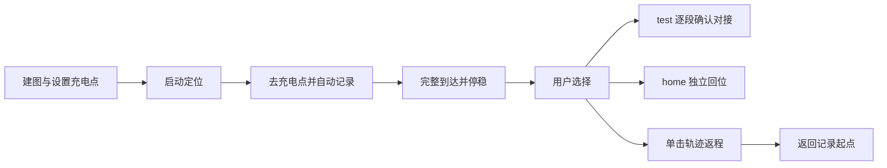
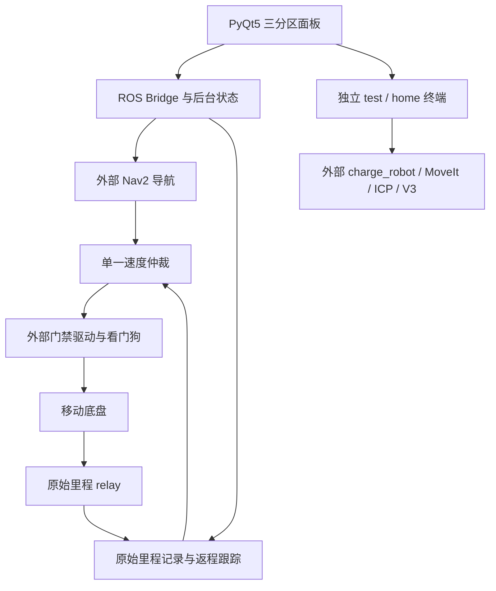

# 国标电车自动充电机器人

[English](README.en.md) · [架构](docs/ARCHITECTURE.md) · [部署](docs/DEPLOYMENT.md) · [测试](docs/TESTING.md)

面向国标电车充电场景的机器人研发项目：将移动底盘导航、实际里程轨迹返程和机械臂对接工具整合到 PyQt5 / ROS 2 工作台。项目展示异步控制、状态管理、模块解耦和故障诊断的工程实现，也为二次开发提供可独立测试的模块。

项目名称描述应用方向，不代表已经通过国标认证或完成无人值守电气充电验收。仓库不公开论文正文、现场地图、轨迹、标定或厂家代码。

## 操作流程

同一面板分为地图与点位、定位与去返程、机械臂工具三个区域。到点后由用户分别选择工具和返程，不要求机械臂成功才能返程。



中途取消的去程不形成可返程记录。返程按同一原始里程计会话中的倒序位姿闭环计算线速度、角速度，不按时间机械重播速度。普通停止取消当前任务；旧任务不会自动恢复。

## 功能架构



本仓库包含面板、桥接、记录/返程、仲裁及自有原生辅助组件；机械臂算法工具链、厂家驱动和标定由部署者提供。

## 验证状态

| 功能 | 已有证据 | 边界 |
| --- | --- | --- |
| 地图、键控、导航去程 | 历史现场使用记录 | 不承诺通用导航精度 |
| 单击原始里程返程 | 用户报告早期版本完整返程成功；本地回归 | 最新改动及目录整理未完成新一轮实车验收 |
| ICP 对齐、V3 枪头预备位 | 用户提供逐段执行成功日志 | 后续插入曾超时，完整电气充电未验证 |
| 停止、失联、任务取消 | 合成数据、假发布器和离线 Qt 回归 | 不替代真实设备验收 |
| 物理急停与下位机断连停车 | 用户报告验证 | 不表述为本仓库自动测试结果 |

## 快速开始

已安装 PyQt5、NumPy、Pillow、PyYAML 的系统 Python 可运行：

```bash
bash start.sh --offline
```

离线预览不连接设备。安装 ROS 2 Humble 的开发环境可运行 `bash tests/run_local.sh`，无需硬件，见[测试说明](docs/TESTING.md)。真实部署需要外部驱动、参数和现场配置，公开配置默认禁用，见[部署指南](docs/DEPLOYMENT.md)。

## 源码组织

| 路径 | 职责 |
| --- | --- |
| `src/charging_robot/ui` | 界面、地图画布和用户操作 |
| `src/charging_robot/navigation` | launch、定位辅助和显示管理 |
| `src/charging_robot/returning` | 记录、会话校验、返程控制 |
| `src/charging_robot/arm` | 外部机械臂工具包装 |
| `src/charging_robot/control` | ROS 桥接、仲裁、停止和看门狗 |
| `src/charging_robot/shared` | 共享模型与状态 |
| `native` / `tests` | 自有 C++ 辅助组件 / 无硬件回归 |

原 `start.sh`、`app.py` 和 ROS launch 等启动入口保留。模块路径映射见[来源布局](docs/source-layout.json)，迁移方式见[架构说明](docs/ARCHITECTURE.md)。

## 运行边界与许可

返程不能发现新增障碍，也不能消除轮滑误差。未经标定的曲率分类拦截已移除，控制器现有输出限幅及通信、轨迹状态检查仍存在。界面卡顿时健康的后台自主控制可能继续，界面停止按钮可能无法响应，需独立硬件急停。详见[返程实现](docs/RAW_ODOM_RETURN.md)。

Pvpproof 自有代码采用 [MIT](LICENSE)。依赖和厂家组件不因此获得 MIT 授权；PyQt 的 GPL/商业许可、建图依赖的非商业声明和不明厂家许可见[第三方边界](THIRD_PARTY_NOTICES.md)与[依赖核查](DEPENDENCIES.md)。

[贡献指南](CONTRIBUTING.md) · [更新日志](CHANGELOG.md) · [源码来源](docs/source-manifest.json)
