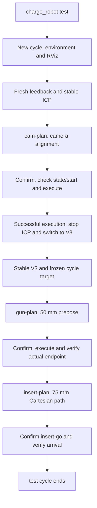
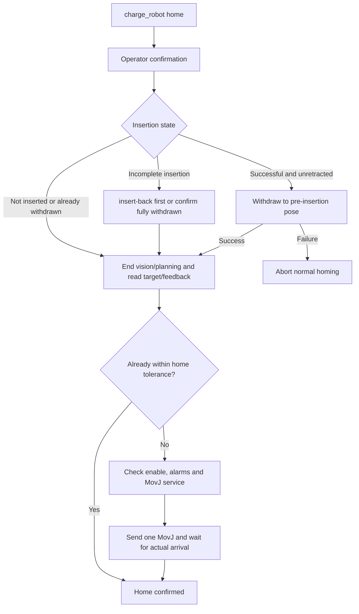
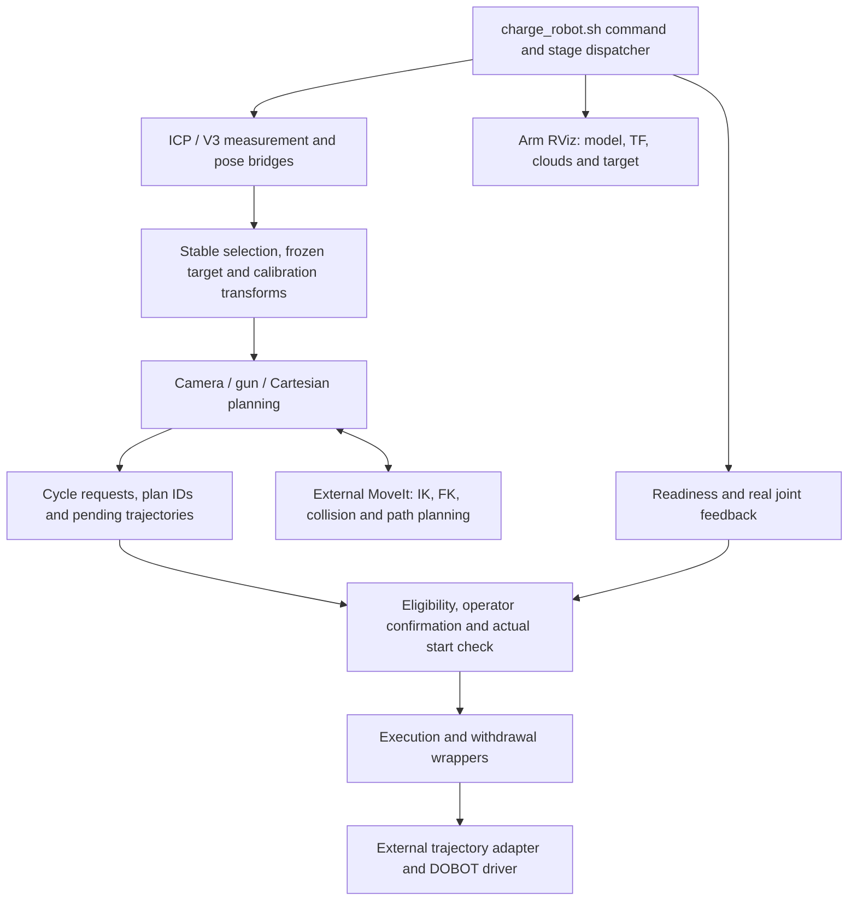
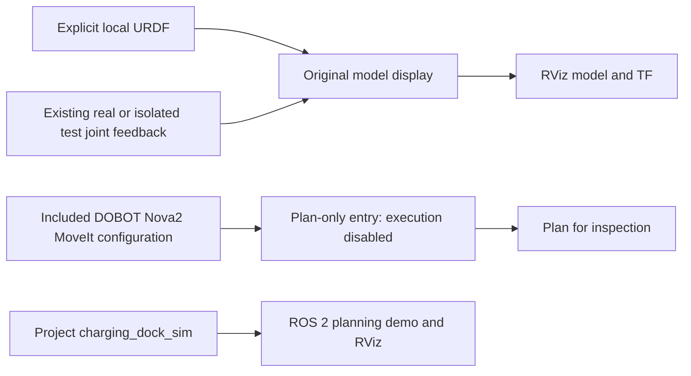

# Arm and vision workflows

[中文](ARM_WORKFLOWS.md) · [English](ARM_WORKFLOWS.en.md) · [首页 / Home](../README.en.md)

These paths describe the recovered originals in `robot_originals/nova2_tools/`, not current hardware acceptance. For commands, see [How to use](HOW_TO_USE.en.md).

## charge_robot test: vision alignment through insertion

`charge_robot test` performs **ICP socket localization → camera alignment → V3 measurement → gun prepose → 75 mm linear insertion**. Planning and vision stages are sequenced automatically, while every motion requires a separate terminal confirmation. Original files have been recovered; see [environment requirements and pending validation](../robot_originals/ENVIRONMENT.md).

1. **Start a new cycle.** Check that execution is idle, clean up previous vision/planning processes, create a new cycle and start the real connection, joint feedback, model/TF, planning-only MoveIt, execution adapter, ICP, pose/cloud bridge and arm RViz. Startup does not automatically home the arm.
2. **Wait for readiness and stable ICP.** Require real connection, fresh complete joints, an actual GetPose response, MoveIt interfaces and valid ICP geometry. Stable measurements and hand-eye calibration provide the planning target.
3. **Plan and execute camera alignment.** `cam-plan` saves a request-bound trajectory. After operator confirmation, validate robot state, eligibility and actual start before execution. Failure prevents the vision transition.
4. **Switch to V3.** Only after successful, matching camera execution, stop the ICP camera/bridge/planner, release the camera and start RGB PnP V3 with its bridge. Freeze a stable representative target for this cycle.
5. **Plan and execute the gun prepose.** `gun-plan` targets a 50 mm standoff using the frozen measurement. Confirm again, verify the start, execute and check the actual gun endpoint. Then close V3/bridge/planning nodes while retaining connection, model, MoveIt and RViz.
6. **Plan the 75 mm insertion.** `insert-plan` binds to the accepted gun prepose, generates/refines a Cartesian line, checks sampled states and saves the trajectory without executing it.
7. **Confirm and execute insertion.** `insert-go` checks plan/cycle binding, depth, enabled stationary state and actual start. After confirmation, submit the trajectory and verify execution plus actual joint arrival. This is position-controlled insertion, not proof of locking, electrical connection or charging.

Required check, planning or execution failures stop subsequent stages. An interruption request does not establish that physical motion has stopped. `test` does not automatically invoke `home` or base return.

## charge_robot home: withdrawal and arm homing

`home` independently returns the arm to the locally saved `initial_arm_pose.yaml`; this is not the mobile base origin.

1. **Confirm homing.** Load the tool environment and request operator confirmation. When an insertion report exists, check the required execution interface.
2. **Determine withdrawal.** Successful, unretracted insertion triggers withdrawal before normal homing; withdrawal failure aborts homing. Incomplete insertion prompts `insert-back` first. The code also permits explicit `HOME` override after the operator confirms the tool is already completely withdrawn. Unreadable state refuses continuation.
3. **End vision/planning.** Check execution is idle, stop ICP/V3/planners and transition the cycle to homing.
4. **Read target and actual joints.** Load the saved pose and inspect feedback/RobotMode. If already within tolerance, send no motion. Otherwise require an enabled, alarm-free state.
5. **Send one home request and verify arrival.** Submit joint targets through `MovJ`, then wait for stable actual arrival. Service acceptance alone is not completion; a response timeout does not automatically resend motion.

Panel test, home and base return are separately initiated. Arm workflow success is not a base-return prerequisite. See [original-source notes](../robot_originals/README.md) for provenance and scope; earlier reconstructed workflow entries have been replaced.

### Toolchain architecture

`test` does not automatically invoke `home` or base return. Arm tools and recorded-route base return remain independent. Command completion does not establish mechanical locking, electrical connection or charging. Workflow/runtime and model-startup helpers now come from the [recovered originals](../robot_originals/README.md).

## Simulation and planning

Original model launch, Nova2 models/meshes, MoveIt configuration, execution adapter and project charging_dock_sim are included. Robot-specific calibration is in robot_originals; the separate Gazebo physics package is absent. Preserve Dobot notices and package declarations. Missing field Git metadata prevents identifying the complete snapshot as one upstream commit; see [upstream audit](../arm_stack/DOBOT_DEPENDENCY.md).

The original-source recovery had 41 passing source, hash, readiness and synthetic timing checks. No RViz/MoveIt/Gazebo or hardware run was performed; end-to-end simulation and physical acceptance remain separate. Commands and requirements are in [How to use](HOW_TO_USE.en.md) and [environment notes](../robot_originals/ENVIRONMENT.md).
