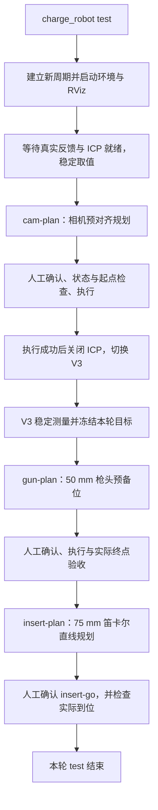
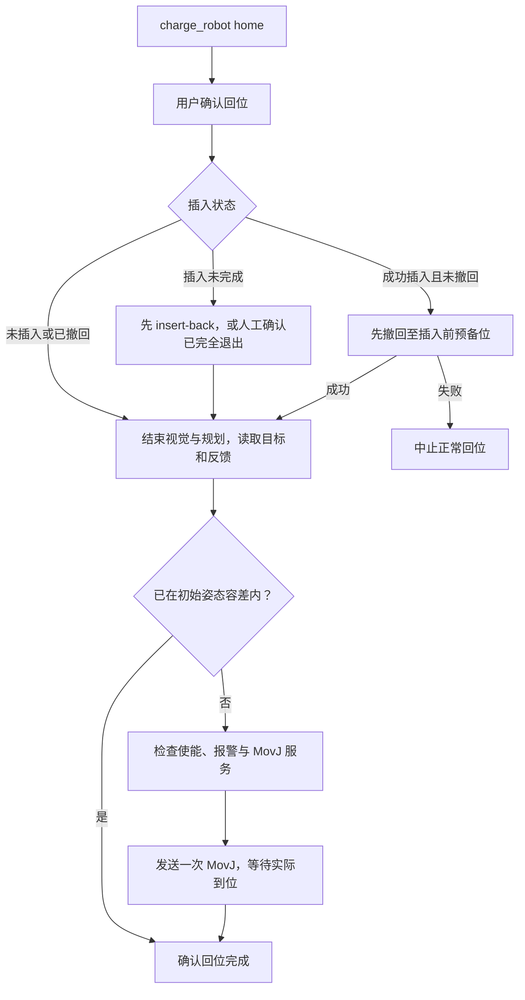
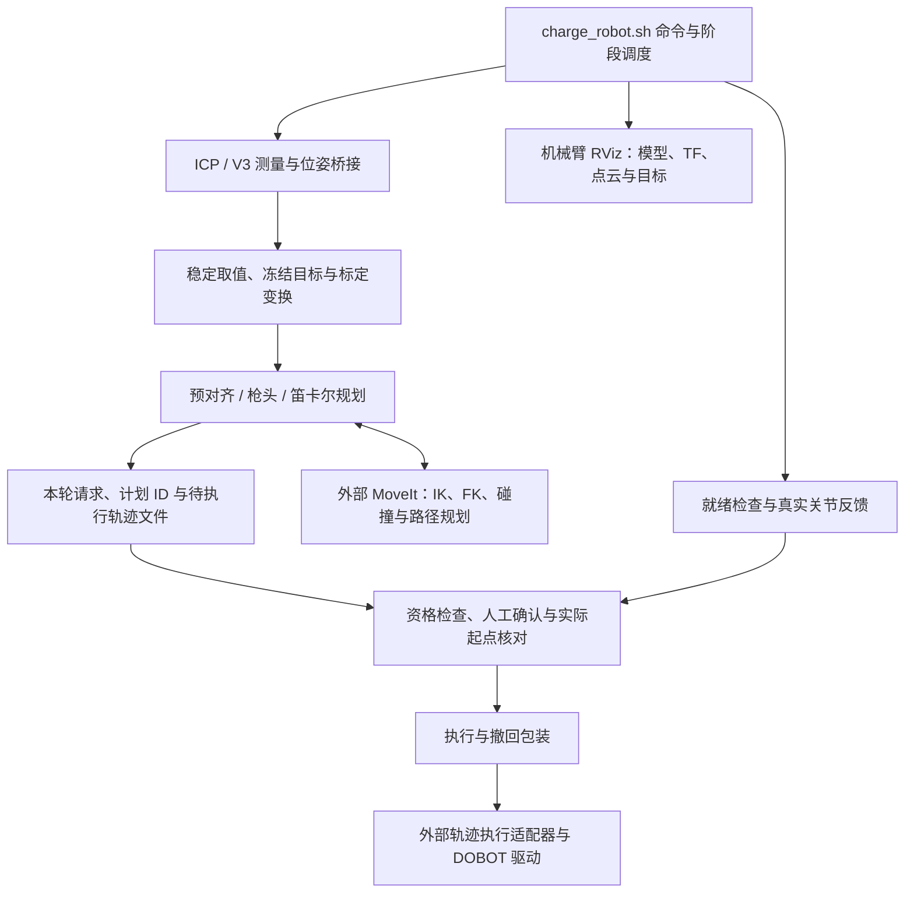
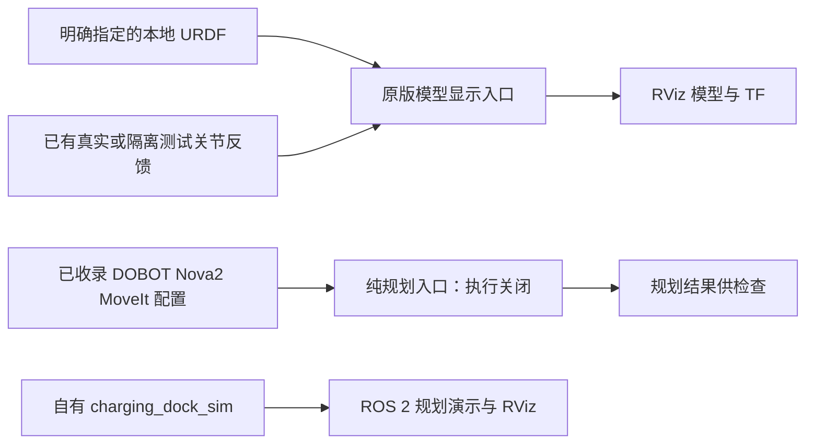

# 机械臂与视觉工作流

[中文](ARM_WORKFLOWS.md) · [English](ARM_WORKFLOWS.en.md) · [首页 / Home](../README.md)

以下依据 `robot_originals/nova2_tools/` 收录的原版代码说明程序路径，不代表当前公开副本已完成实机验收。运行步骤见 [How to use](HOW_TO_USE.md)。

## charge_robot test：从视觉定位到插入

`charge_robot test` 执行一轮机械臂预对接与插入：**ICP 找充电口 → 相机预对齐 → V3 精测 → 枪头预备位 → 75 mm 直线插入**。程序自动衔接规划和视觉阶段，每段运动仍在终端单独确认。原版文件已恢复；部署所需环境与未验证事项见[环境说明](../robot_originals/ENVIRONMENT.md)。

1. **启动本轮环境。** 检查执行器是否空闲，清理上一轮视觉/规划进程并建立新周期；启动真实连接、关节反馈、模型与 TF、MoveIt 纯规划、轨迹执行适配器、ICP、位姿/点云桥接和机械臂 RViz。此步骤不自动回初始姿态。
2. **等待 ICP 与机械臂就绪。** 检查真实连接、完整且新鲜的关节反馈、GetPose 实际响应、MoveIt 接口和有效 ICP 几何位姿。多帧稳定取值后，结合手眼标定把相机测量转换为机械臂规划目标。
3. **规划并执行相机预对齐。** `cam-plan` 计算预对齐轨迹并保存本轮请求及计划 ID。终端要求确认工作区后，核对机器人状态、计划资格和真实起点，再提交执行；失败则不切换下一视觉阶段。
4. **切换为 V3 精测。** 相机轨迹执行成功且请求匹配后，关闭 ICP 相机、桥接与相机规划节点，释放相机，再启动 RGB PnP V3 及其桥接。V3 多帧稳定后冻结本轮代表目标，避免规划过程中不断追逐更新值。
5. **规划并执行枪头预备位。** `gun-plan` 使用冻结目标规划距充电口 50 mm 的枪头预备位。再次由用户确认，检查实际起点后执行，并核对实际枪头终点。该阶段结束后关闭 V3、桥接和相关规划节点，保留连接、模型、MoveIt 与 RViz。
6. **规划 75 mm 轴向插入。** `insert-plan` 以本轮已验收的枪头预备位为来源，生成笛卡尔直线路径、进行细化与采样检查，保存插入计划；此时尚未运动。
7. **确认并执行插入。** `insert-go` 检查计划/周期绑定、75 mm 范围、静止使能状态与真实起点。终端再次确认后提交轨迹，读取执行结果并等待实际关节到位。这里是位置控制插入，不代表已经验证锁止、电气连接或充电。

任何必需检查、规划或执行失败都会中止后续步骤；中断请求本身不证明机械臂已经停稳。`test` 结束后不会自动 `home` 或启动底盘返程。

## charge_robot home：撤回与机械臂回位

`home` 是独立的机械臂回位命令，目标来自本地保存的 `initial_arm_pose.yaml`，不是底盘起点。

1. **用户确认回位。** 加载工具环境，要求确认机械臂将回初始姿态；存在插入报告时先检查所需执行接口。
2. **判断是否先撤回。** 本轮插入成功且尚未撤回时，先调用撤回流程；撤回失败则中止正常回位。若插入未完成或状态不确定，提示先 `insert-back`；代码也保留人工确认枪头已完全退出后输入 `HOME`、跳过自动撤回的路径。状态文件无法可靠读取时拒绝继续。
3. **结束视觉与规划阶段。** 确认执行器空闲，关闭 ICP、V3 和相关规划节点，将本轮状态转为回位。
4. **读取目标与实际关节。** 加载保存的初始关节姿态，读取真实反馈和 RobotMode；若已在目标容差内，不发送回位运动。需要移动时，要求使能状态和无报警。
5. **发送一次回位并确认到达。** 经 `MovJ` 服务发送关节回位目标，等待实际关节稳定到位后才报告成功。服务返回成功只表示控制器接收；响应超时不自动重发，避免重复动作。

面板中的 `test`、`home` 和底盘返程分别由用户发起，不要求机械臂流程成功才能选择底盘返程。原版工作流来源与恢复范围见[原件说明](../robot_originals/README.md)；不再使用早期重建入口。

### 工具链内部架构

`test` 不自动调用 `home` 或底盘返程；面板中的机械臂工具与底盘去返程独立。命令成功也不等于锁止、电气连接或实际充电已经验证。工作流、运行时辅助及模型启动均已由原件恢复，来源见 [原件说明](../robot_originals/README.md)。

## 仿真与规划

原模型启动、Nova2 模型/网格、MoveIt 配置、执行适配器与自有 `charging_dock_sim` 已收录；本车手眼标定在 `robot_originals/`。独立 Gazebo 物理仿真包未包含。DOBOT 副本保留原版权和包声明，现场缺 Git 元数据，不能据此确定整套上游提交。见 [DOBOT 来源与许可](../arm_stack/DOBOT_DEPENDENCY.md)。

可以离线阅读和运行针对性检查。原件恢复时 41 项源码、哈希、就绪与合成时序检查通过；未启动 RViz/MoveIt/Gazebo，未完成仿真或实机全流程验收。命令和当前边界见 [How to use](HOW_TO_USE.md)与[环境说明](../robot_originals/ENVIRONMENT.md)。
